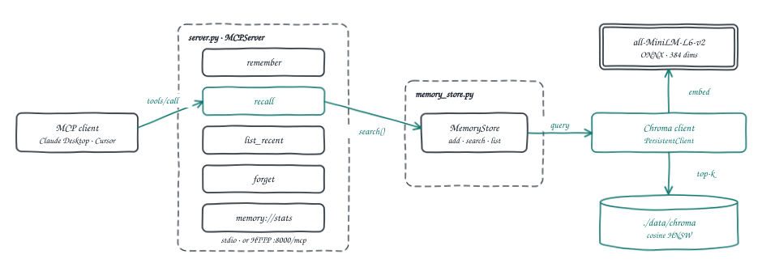

# mcp-memory-demo

An open-source, MIT-licensed reference **MCP (Model Context Protocol) server**
that gives any MCP client a long-term personal memory. Memories are embedded
and searched **locally** with ChromaDB and a small embedding model, so there
are no API keys, no hosted services and nothing to pay for.

The worked example is a **personal memory**. You tell your assistant "remember
that I'm allergic to shellfish"; days later you ask "what should I avoid
ordering?" and the assistant recalls it by meaning, not by keyword.

It is meant to be read, run and forked: one file for the MCP surface, one file
for the RAG store, about 200 lines in total. Swap the store or the embedding
model to turn it into memory for notes, tickets or code.

> **Status:** learning template and proof of concept. Not hardened for
> production — see [Known limits](#known-limits).

**Live demo:** none. It runs on your own machine in about two minutes — see
[Quick start](#quick-start).



*The recall path (highlighted): `tools/call recall` → `MemoryStore.search()` →
Chroma embeds the query with all-MiniLM-L6-v2 and returns the nearest memories
from a cosine HNSW index on disk.*

---

## What you can learn from it

- **The MCP tool / resource split.** Actions the model chooses to take
  (`remember`, `recall`, `list_recent`, `forget`) are tools; read-only context
  (`memory://stats`) is a resource. See `server.py`.
- **Tool descriptions are the prompt.** There is no system prompt. The model
  decides when to call each tool from its name, docstring and `Field`
  descriptions, so those strings are written for the model.
- **A local RAG pipeline in 100 lines.** `memory_store.py` stores text, tags,
  source and a timestamp in Chroma, and turns cosine distance into a score.
- **One server, two transports.** The same code serves stdio (spawned by a
  desktop client) and streamable HTTP (`--http`).
- **Agent memory in CoALA terms.** `remember` is a learning action, `recall` a
  retrieval action, and the store is long-term episodic memory.

The full design document is in **[docs/DESIGN.md](docs/DESIGN.md)**.

---

## Quick start

Requires Python 3.10+ and [`uv`](https://docs.astral.sh/uv/) (or plain `pip`).

```bash
git clone https://github.com/nitingoswami-io/mcp-memory-demo.git
cd mcp-memory-demo
uv sync                       # or: pip install -e .
uv run seed.py                # stores 5 sample memories and runs one recall
```

The first run downloads the embedding model (about 80 MB) into
`~/.cache/chroma`. After that everything runs offline. `seed.py` should end
with the reading-list memory as the top hit for "what should I read next?".

Start the MCP server:

```bash
uv run server.py              # stdio, for desktop clients that spawn it
uv run server.py --http       # streamable HTTP at http://127.0.0.1:8000/mcp
```

No keys are needed. Two optional settings (also in
[`.env.example`](.env.example)):

| Variable | Used for | Default |
|---|---|---|
| `MCP_MEMORY_PATH` | Where Chroma stores the database | `./data/chroma` |
| `MCP_MEMORY_COLLECTION` | Collection name, to keep separate memories | `personal_memory` |

The server reads these from the environment; it does not load a `.env` file.

### Test it locally

No LLM client is needed for any of these.

```bash
uv run pytest -q              # unit tests for the RAG store (offline after the model download)
uv run test_server.py         # smoke test: spawns the server over stdio and calls every tool
uv run mcp dev server.py      # MCP Inspector: click through tools and resources in a browser
```

The smoke test prints `[OK]` per step and ends with `All smoke tests passed.`;
it exits non-zero on any failure. The Inspector opens at
`http://localhost:5173`: click **Connect**, pick a tool, fill in arguments and
hit **Call Tool**.

### Hook it up to Claude Desktop

Edit `~/Library/Application Support/Claude/claude_desktop_config.json`
(macOS) or the equivalent on your OS, and merge in
[`examples/claude_desktop_config.json`](examples/claude_desktop_config.json):

```json
{
  "mcpServers": {
    "personal-memory": {
      "command": "uv",
      "args": ["--directory", "/absolute/path/to/mcp-memory-demo", "run", "server.py"]
    }
  }
}
```

Restart Claude Desktop. The four `personal-memory` tools appear in the tools
menu. Try:

> *"Remember that I'm allergic to shellfish."*
> *"What did I say about my project kickoff?"*

Other MCP clients (Cursor, Zed, your own agent) take the same command and
arguments.

---

## How it works

```
MCP client ──tools/call──▶ server.py ──▶ memory_store.py ──▶ Chroma ──▶ ./data/chroma
 (stdio or HTTP)           4 tools +      MemoryStore        embed with   cosine HNSW
                           1 resource                        MiniLM (ONNX)
```

| Stage | Where |
|---|---|
| MCP surface: tools `remember`, `recall`, `list_recent`, `forget`; resource `memory://stats` | `server.py` |
| Store, search, list, delete; distance → score; tag filter | `memory_store.py` (`MemoryStore`) |
| Embeddings: Chroma's default function, all-MiniLM-L6-v2 via ONNX, 384 dimensions | Chroma, cached in `~/.cache/chroma` |
| Persistence | `./data/chroma` (or `MCP_MEMORY_PATH`) |
| Sample data | `seed.py` |

| Tool | Purpose |
|---|---|
| `remember` | Store a memory with optional tags and source. Returns its id. |
| `recall` | Semantic search; optional tag filter; returns a similarity score (1 − cosine distance). |
| `list_recent` | Newest first. The model uses this for "what did I just…". |
| `forget` | Delete a memory by id. Returns whether one was removed. |

| Resource | Returns |
|---|---|
| `memory://stats` | Plain-text summary: count, collection, storage path. |

**Stack:** Python · [MCP Python SDK](https://github.com/modelcontextprotocol/python-sdk) (`MCPServer`) · ChromaDB · all-MiniLM-L6-v2.

---

## Adapting it

| You want to… | Change |
|---|---|
| Store something other than personal facts (notes, tickets, code snippets) | Tool docstrings and `Field` descriptions in `server.py`; metadata fields in `MemoryStore.add` |
| Use a better embedding model (OpenAI, Voyage, Cohere, Ollama) | Pass an `embedding_function` to `get_or_create_collection` in `memory_store.py` ([Chroma docs](https://docs.trychroma.com/)) |
| Use another vector store (pgvector, Qdrant) | Reimplement `MemoryStore`; `server.py` only calls `add`, `search`, `list_recent`, `delete`, `stats` |
| Expose more context without a tool call | Add `@mcp.resource(...)` functions in `server.py` (e.g. "last 24 hours", "by tag") |
| Filter by time or source | Add `where` filters on `created_at` / `source` in `MemoryStore.search` |

---

## Deploying your own copy

This server is built to run **locally**, next to the client that uses it.
stdio mode never opens a network port. HTTP mode binds to `127.0.0.1:8000`
and has **no authentication**, so anyone who can reach the port can read and
delete every memory.

If you want to host it for remote clients:

1. **Add authentication first.** Put it behind an authenticating reverse proxy,
   or add OAuth on the HTTP transport, before it listens on a public address.
2. **Scope memories per user.** One collection per user id
   (`MCP_MEMORY_COLLECTION` is the simplest switch), never one shared store.
3. **Rate-limit and cap input size.** There is no paid API to protect, but each
   `remember` grows the database. Limit requests per client at your proxy or
   host firewall, and cap `content` length on the server.
4. **Back up `MCP_MEMORY_PATH`.** It is the only copy of the memories.

If you swap in a hosted embedding model, each call then costs money: use
prepaid credit with auto-recharge off at the provider, as well as the rate
limits above.

---

## Known limits

- **No authentication on HTTP.** Fine on localhost; not safe on a network.
  See [Deploying your own copy](#deploying-your-own-copy).
- **One shared memory.** Every client that connects reads and writes the same
  collection. Multi-user needs per-user collections and auth.
- **Pure vector search.** Short or exact queries ("last Tuesday", a name) can
  miss. Hybrid search (BM25 + vectors) and date filters would help.
- **Tag filtering happens after search.** With tags, it fetches `limit × 5`
  (at most 100) neighbours and filters them, so a rare tag can return fewer
  results than asked for.
- **`list_recent` loads every memory** to sort by date. Fine for thousands of
  memories, slow for millions.
- **No deduplication or consolidation.** Saying the same thing twice stores it
  twice.
- **Small embedding model.** all-MiniLM-L6-v2 is fast and free but English-first
  and less accurate than larger hosted models.

---

## Contributing

Contributions that make this easier to understand or adapt are welcome. See
[CONTRIBUTING.md](CONTRIBUTING.md) — fork, branch, open a pull request.
Questions and ideas go in [issues](https://github.com/nitingoswami-io/mcp-memory-demo/issues).

## License

[MIT](LICENSE) © 2026 Nitin Goswami
