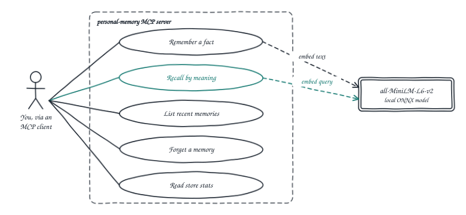
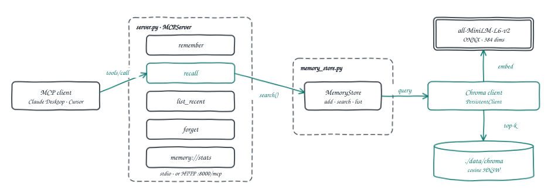
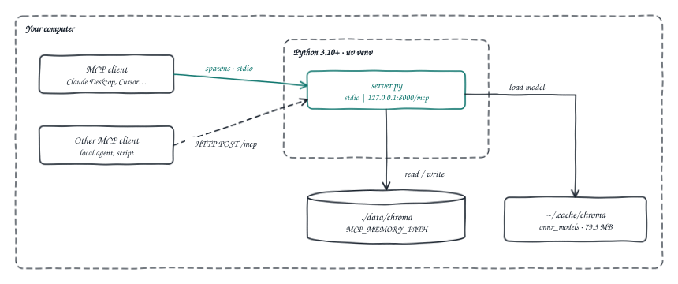
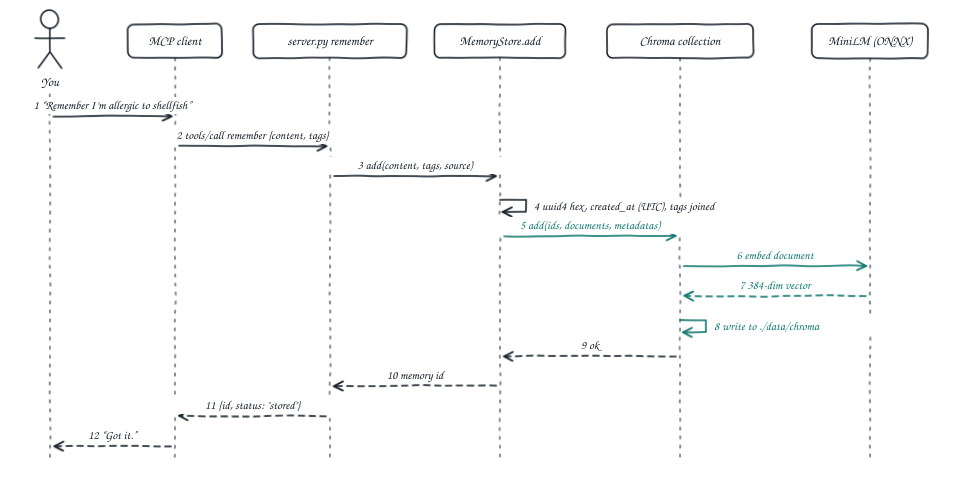
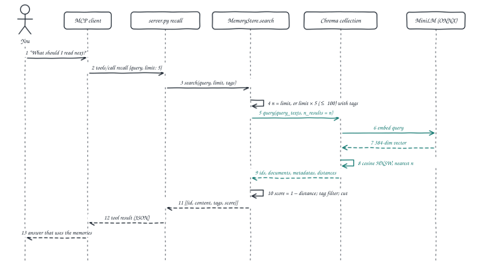
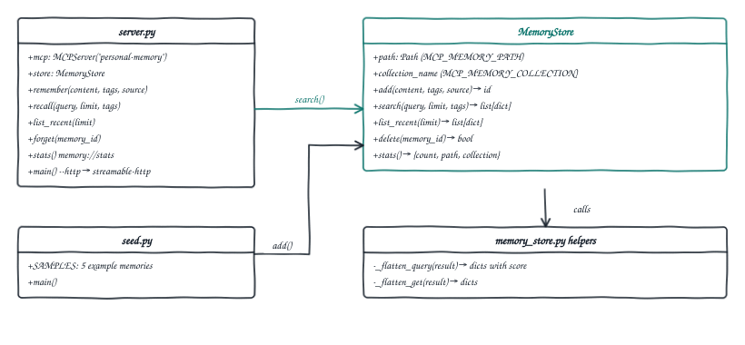
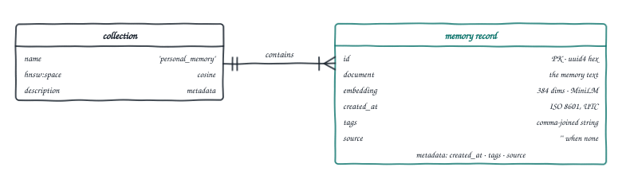

# MCP Memory Demo: give any MCP client a long-term memory it can search by meaning

`DESIGN DOCUMENT · mcp-memory-demo`

*A local MCP server that lets Claude Desktop, Cursor or your own agent remember facts and recall them by meaning later. Each tool maps to a CoALA memory action.*

| Stack | Models | Date | Status |
|---|---|---|---|
| Python · MCP Python SDK (`MCPServer`) · ChromaDB · uv | `all-MiniLM-L6-v2` (local, ONNX) · the client's own LLM | 26 Oct 2026 | Approved · built |

[View code](https://github.com/nitingoswami-io/mcp-memory-demo) · [Fork](https://github.com/nitingoswami-io/mcp-memory-demo/fork) · [Report an issue](https://github.com/nitingoswami-io/mcp-memory-demo/issues/new) · [Contribute](https://github.com/nitingoswami-io/mcp-memory-demo/blob/main/CONTRIBUTING.md)

---

## 1. Purpose & scope

The demo teaches how an agent gets memory that outlives one conversation. The MCP server owns a **long-term episodic memory**: a Chroma collection of things the user said, each with a timestamp, tags and a source. The client's model writes to it with a **learning action** (`remember`) and reads from it with a **retrieval action** (`recall`). Recalled memories land in the model's **working memory** (the context window) as a tool result, and the model **reasons** over them to answer. The vocabulary follows the CoALA framework (after Sumers et al., 2023). The protocol between client and server is MCP, so any MCP client gets the same memory.

**CoALA pipeline**

| Stage | Key | Does | CoALA role |
|---|---|---|---|
| 1 | `remember` | Store one memory | Learning action |
| 2 | `personal_memory` | Embed · index on disk | Episodic memory (long-term) |
| 3 | `recall` | Embed query · top-k | Retrieval action |
| 4 | `CallToolResult` | Memories in context | Working memory |
| 5 | client LLM | Answer using memories | Reasoning → external action |

### In scope

- Expose four MCP tools (`remember`, `recall`, `list_recent`, `forget`) and one resource (`memory://stats`).
- Embed and search memories locally with Chroma's default embedding function (all-MiniLM-L6-v2 via ONNX). No API keys.
- Return a similarity score (1 − cosine distance) with every recalled memory, and filter by tags.
- Serve the same code over stdio (spawned by a desktop client) and streamable HTTP (`--http`).
- Seed five sample memories and run one recall with `seed.py`.

### Out of scope

Authentication and per-user memories, deduplication or consolidation of repeated facts, time-range and source filters, hybrid keyword + vector search, and any user interface of its own (the MCP client is the interface). Section 10 lists these as follow-ups.

## 2. Use cases



*Fig. 1: Use case diagram: five things a person can do with their memory through any MCP client.*

| ID | Use case | Behaviour |
|---|---|---|
| UC1 | Remember a fact | The model calls `remember` with the text and optional tags and source. The server stores it and returns `{id, status: "stored"}`. |
| UC2 | Recall by meaning | The model calls `recall` with a natural-language query. The server returns up to `limit` (default 5) memories, each with a `score`, best first. |
| UC3 | List recent memories | The model calls `list_recent`. The server returns up to `limit` (default 10) memories, newest first. |
| UC4 | Forget a memory | The model calls `forget` with an id. The server deletes it and returns `deleted: true`, or `false` if no such id exists. |
| UC5 | Read store stats | The client reads `memory://stats`. The server returns the count, collection name and storage path as text. |

## 3. Architecture

There is one runtime part: a Python process running `server.py`. It owns the MCP surface (tool and resource definitions, transport). `memory_store.py` owns storage and search, through Chroma's `PersistentClient`. Chroma owns embedding (the MiniLM ONNX model, cached in `~/.cache/chroma`) and the on-disk index in `./data/chroma`. The LLM lives in the MCP client, not in this repo.



*Fig. 2: Component diagram: the recall path from the MCP client through server.py, MemoryStore and Chroma to the on-disk index.*



*Fig. 3: Deployment view for a single computer: stdio subprocess by default, HTTP on 127.0.0.1:8000 as an option.*

## 4. Key flows

### 4.1 Remember: tools/call → add → embed → write



*Fig. 4: Sequence: remember (CoALA learning action).*

### 4.2 Recall: tools/call → embed query → nearest neighbours → score



*Fig. 5: Sequence: recall (CoALA retrieval action).*

With tags, `search` asks Chroma for `limit × 5` neighbours (at most 100), keeps those that share any tag, and cuts to `limit`. Without tags it asks for exactly `limit`.

## 5. Backend design



*Fig. 6: Class diagram: server.py tools delegate to MemoryStore, which wraps the Chroma collection.*

| File | Responsibility |
|---|---|
| `server.py` | Creates `MCPServer("personal-memory")`, defines the four tools and the `memory://stats` resource, picks stdio or streamable HTTP in `main()`. |
| `memory_store.py` | `MemoryStore`: opens the persistent Chroma collection (cosine HNSW), adds, searches, lists, deletes, counts. Turns Chroma's nested results into flat dicts. |
| `seed.py` | Adds five sample memories and prints the top 3 hits for "what should I read next?". |
| `tests/test_memory_store.py` | Five offline tests of `MemoryStore` against a temporary directory. |
| `examples/claude_desktop_config.json` | The `mcpServers` entry for Claude Desktop. |

### System prompt

None. The server sends no system prompt. The model decides when and how to call each tool from its name, docstring and parameter descriptions, so those strings do a prompt's job. Verbatim from `server.py`:

```text
remember     Store a new memory. Returns the generated memory id.
  content    The memory text to store.
  tags       Optional tags for filtering later, e.g. ['work', 'idea'].
  source     Optional provenance, e.g. 'slack', 'notebook', 'conversation'.
recall       Semantically search stored memories. Returns the top matches with similarity scores.
  query      Natural-language query to search memories.
  limit      Max results to return.            (1–50, default 5)
  tags       If set, only return memories tagged with any of these.
list_recent  List the most recent memories in reverse chronological order.
  limit      Max results.                      (1–100, default 10)
forget       Delete a memory by id. Returns whether a memory was actually removed.
  memory_id  The id of the memory to delete.
memory://stats  A plain-text summary of the memory store state.
```

### API contract

MCP over JSON-RPC 2.0. Transport: stdio, or streamable HTTP at `POST http://127.0.0.1:8000/mcp` (responses as `text/event-stream`, session in the `mcp-session-id` header).

| Method | Path | Request | Response |
|---|---|---|---|
| `tools/list` | — | — | 4 tools with JSON Schemas |
| `tools/call` | `remember` | `content`, `tags?`, `source?` | `{id, status: "stored"}` |
| `tools/call` | `recall` | `query`, `limit?` (1–50, 5), `tags?` | `[{id, content, created_at, tags, source, score}]` |
| `tools/call` | `list_recent` | `limit?` (1–100, 10) | `[{id, content, created_at, tags, source}]` |
| `tools/call` | `forget` | `memory_id` | `{id, deleted}` |
| `resources/read` | `memory://stats` | — | text: count, collection, storage path |

Errors: invalid arguments (a missing `content`, `limit` out of range) and unknown tool names come back as a tool result with `isError: true` and the validation message; `forget` on an unknown id is not an error, it returns `deleted: false`.

## 6. Data model

Chroma creates the schema on first use: `get_or_create_collection("personal_memory", metadata={"hnsw:space": "cosine", …})`. One record is one memory: a uuid4 hex id, the text, its 384-dimension embedding, and three metadata fields. Chroma metadata can't hold lists, so tags are stored as one comma-joined string and split again on read.



*Fig. 7: Entity-relationship diagram of the Chroma collection.*

## 7. Frontend design

Not applicable: the demo has no UI of its own. The MCP client (Claude Desktop, Cursor, an agent) is the frontend; it shows tool calls and their results in its own interface.

## 8. Project layout

```text
mcp-memory-demo/
├── server.py                     MCP surface: 4 tools, 1 resource, transports
├── memory_store.py               MemoryStore over a Chroma collection
├── seed.py                       5 sample memories + one recall
├── tests/test_memory_store.py    offline tests (pytest)
├── examples/
│   └── claude_desktop_config.json
├── docs/
│   ├── DESIGN.md                 this document
│   └── figures/                  fig-01 … fig-07 (hand-drawn SVG)
├── .github/                      CI · issue and PR templates
├── .env.example                  MCP_MEMORY_PATH · MCP_MEMORY_COLLECTION
├── pyproject.toml                mcp[cli] ≥ 2.0 · chromadb ≥ 1.0 · pytest (dev)
├── CONTRIBUTING.md · LICENSE (MIT) · README.md
└── data/chroma/                  created at run time, git-ignored
```

## 9. Run & verify

```bash
git clone https://github.com/nitingoswami-io/mcp-memory-demo.git && cd mcp-memory-demo
uv sync                     # Python 3.10+; installs mcp, chromadb, pytest
uv run seed.py              # first run downloads the MiniLM model (79.3 MB)
uv run pytest -q            # 5 passed, offline
uv run server.py            # stdio; or: uv run server.py --http  → http://127.0.0.1:8000/mcp
# then add examples/claude_desktop_config.json to Claude Desktop and restart it
```

| Check | Expected |
|---|---|
| `uv run seed.py` | Five `stored <id>` lines, `Total memories: 5`, then the reading-list memory as the top hit for "what should I read next?" (score 0.3483 in our run). |
| `tools/list` from any MCP client | `remember`, `recall`, `list_recent`, `forget`; `resources/list` shows `memory://stats`. |
| `recall` "who leads project atlas?" after seeding | The Project Atlas memory first, with `tags: ["work", "project-atlas"]`, `source: "slack"`, score 0.7568 in our run. |
| `forget` with an id that doesn't exist | `{"id": "…", "deleted": false}`, not an error. |
| `recall` with `limit: 0` | Tool error: "Input should be greater than or equal to 1". |
| HTTP: `POST /mcp` with `initialize` | `200 OK`, `content-type: text/event-stream`, an `mcp-session-id` header. |

## 10. Next steps

| Idea | What it teaches |
|---|---|
| Hybrid search: BM25 + vector score, then rerank | Why pure embeddings miss names and exact phrases; a better **retrieval action**. |
| `created_at` range and `source` filters in `recall` | Structured retrieval alongside semantic retrieval; "last Tuesday" queries. |
| Consolidation: merge near-duplicate memories, summarise old ones | Reflection as a **learning action** that rewrites long-term memory (after Park et al., 2023). |
| Split facts from events: a semantic store next to the episodic one | The CoALA difference between **semantic** and **episodic memory**. |
| OAuth on the HTTP transport and one collection per user | What changes when memory is shared: auth, isolation, audit. |
| More resources (`memory://recent`, `memory://tags/{tag}`) | When context should be read by the client rather than fetched by a tool call. |

### Contribute

Fork the repo, pick an idea from the table, and open a pull request. Bugs and unclear steps go in issues.
[Fork](https://github.com/nitingoswami-io/mcp-memory-demo/fork) · [Report an issue](https://github.com/nitingoswami-io/mcp-memory-demo/issues/new) · [How to contribute](../CONTRIBUTING.md)

## Credits & sources

1. Theodore R. Sumers, Shunyu Yao, Karthik Narasimhan, Thomas L. Griffiths. [*Cognitive Architectures for Language Agents*](https://arxiv.org/abs/2309.02427) (2023). The CoALA vocabulary (episodic and working memory, learning, retrieval and reasoning actions) used to map each tool.
2. Model Context Protocol. [*Specification*](https://modelcontextprotocol.io/specification/2026-07-28) (revision 2026-07-28). The tool / resource split, JSON-RPC methods and the stdio and streamable HTTP transports.
3. Model Context Protocol. [*MCP Python SDK*](https://github.com/modelcontextprotocol/python-sdk). `MCPServer`, the `@tool` / `@resource` decorators and the client used to test the server. MIT licence.
4. Chroma. [*Chroma*](https://github.com/chroma-core/chroma). The persistent vector store, cosine HNSW index and default embedding function. Apache-2.0 licence.
5. sentence-transformers. [*all-MiniLM-L6-v2*](https://huggingface.co/sentence-transformers/all-MiniLM-L6-v2). The 384-dimension embedding model Chroma runs locally. Apache-2.0 licence.
6. Joon Sung Park et al. [*Generative Agents: Interactive Simulacra of Human Behavior*](https://arxiv.org/abs/2304.03442) (2023). The idea of reflection over a memory stream, cited in Next steps.
7. Original work. The server, store wrapper, tests and figures are new in this demo.

---

mcp-memory-demo · design document · source of truth: `docs/DESIGN.md` in the repository.
